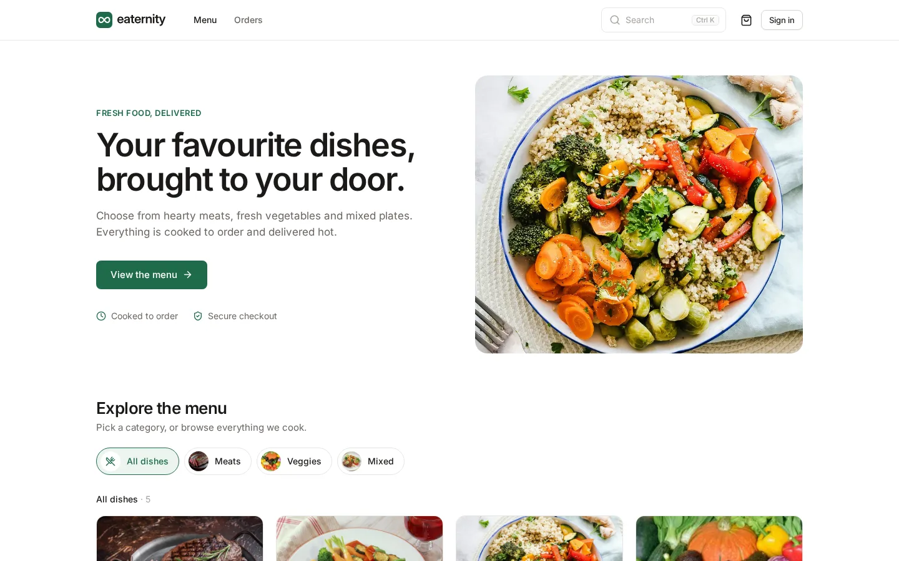
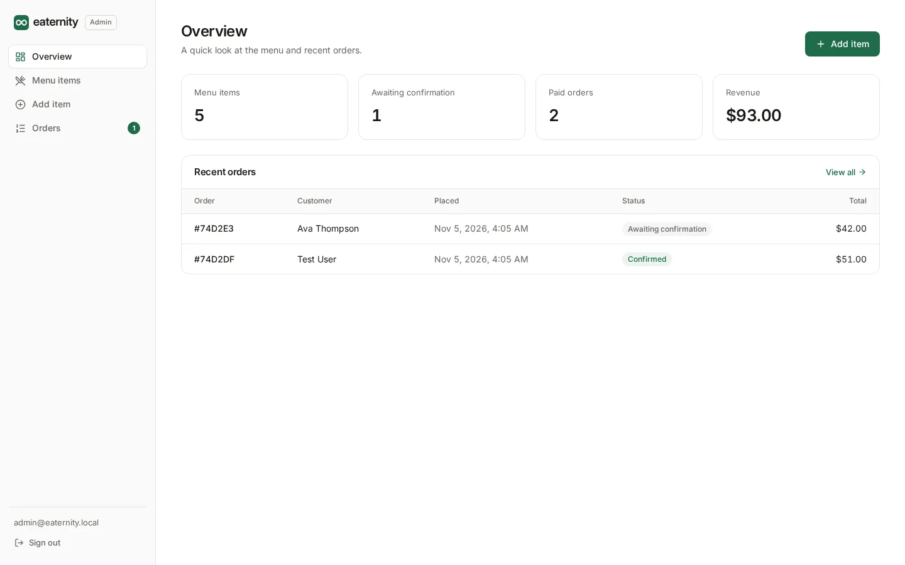

<p align="center">
  <picture>
    <source media="(prefers-color-scheme: dark)" srcset="docs/logo-dark.svg">
    
  </picture>
</p>

Eaternity is a food ordering web app. Customers browse the menu, fill a cart and pay with Stripe. Staff add dishes and confirm orders from a separate admin panel. The API is Express with MongoDB, the two frontends are React, and everything is written in TypeScript.



## Run it with Docker

All you need is Docker with the Compose plugin.

```sh
curl -O https://raw.githubusercontent.com/shtmthw/eaternity/main/docker-compose.yml
docker compose up -d
```

Then open:

- http://localhost:8080 for the shop
- http://localhost:8080/admin for the admin panel

The admin email is `admin@eaternity.local`. A password is generated on first start and printed in the logs. You can read it again at any time:

```sh
docker compose exec app cat /data/admin-password
```

The menu starts out empty. Sign in to the admin panel, add a few dishes and they appear in the shop straight away.

Without a Stripe key the app runs in demo mode. Checkout skips the payment page and the order is marked as paid. See [Configuration](#configuration) for real payments and confirmation emails.

`docker compose down` stops everything. Data lives in two named volumes, `app-data` (uploaded images and generated secrets) and `mongo-data` (the database). Run `docker compose down -v` to delete them too.

The image is [matthew552/eaternity](https://hub.docker.com/r/matthew552/eaternity) on Docker Hub. It is built for `linux/amd64` and `linux/arm64`, so it runs natively on Intel, AMD and Apple Silicon machines.

### Without Compose

```sh
docker network create eaternity
docker run -d --name eaternity-mongo --network eaternity -v eaternity-mongo:/data/db mongo:8
docker run -d --name eaternity --network eaternity -p 8080:8080 \
  -e MONGODB_URI=mongodb://eaternity-mongo:27017/eaternity \
  -v eaternity-data:/data \
  matthew552/eaternity
docker logs eaternity
```

## Configuration

Settings are environment variables and every one of them is optional. With Compose, put them in a `.env` file next to `docker-compose.yml`. [`.env.example`](.env.example) lists them all.

| Variable                 | Default                               | Description                                                                                                                            |
| ------------------------ | ------------------------------------- | -------------------------------------------------------------------------------------------------------------------------------------- |
| `PORT`                   | `8080`                                | Port the server listens on. With Compose, the port on your machine.                                                                    |
| `ADMIN_EMAIL`            | `admin@eaternity.local`               | Email for the admin panel.                                                                                                             |
| `ADMIN_PASSWORD`         | generated                             | Password for the admin panel. When empty, one is generated on first start and saved to `admin-password` in the data directory.         |
| `JWT_SECRET`             | generated                             | Signs login tokens. When empty, one is generated and saved in the data directory.                                                      |
| `JWT_EXPIRES_IN`         | `7d`                                  | How long a sign-in lasts, for example `12h` or `30d`.                                                                                  |
| `STRIPE_SECRET_KEY`      |                                       | Turns on Stripe Checkout. Without it, payments run in demo mode.                                                                       |
| `PAYMENT_CURRENCY`       | `usd`                                 | Currency Stripe charges in.                                                                                                            |
| `PAYMENT_EXCHANGE_RATE`  | `1`                                   | Rate from USD to `PAYMENT_CURRENCY`. Menu prices are always entered in USD.                                                            |
| `PUBLIC_URL`             | the requested host                    | Address Stripe sends customers back to. Set it when the app is behind a proxy or on its own domain.                                    |
| `SMTP_HOST`              | `smtp.gmail.com`                      | Mail server for order confirmation emails.                                                                                             |
| `SMTP_PORT`              | `465`                                 | Mail server port.                                                                                                                      |
| `SMTP_SECURE`            | `true`                                | Use TLS from the start of the connection. Set to `false` for port 587.                                                                 |
| `SMTP_USER`, `SMTP_PASS` |                                       | Mail credentials. Emails are sent only when both are set. For Gmail, use an [app password](https://myaccount.google.com/apppasswords). |
| `MAIL_FROM`              | `SMTP_USER`                           | Sender address.                                                                                                                        |
| `MONGODB_URI`            | `mongodb://127.0.0.1:27017/eaternity` | Database connection string. The Compose file sets this for you.                                                                        |
| `DATA_DIR`               | `./data`, or `/data` in Docker        | Where uploaded images and generated secrets are stored.                                                                                |

To charge in a currency other than US dollars, set both currency values. For example, `PAYMENT_CURRENCY=bdt` and `PAYMENT_EXCHANGE_RATE=80` charges in Bangladeshi taka at 80 taka to the dollar.

## How orders work

1. Anyone can add dishes to the cart. Guests keep their cart in the browser, and it is merged into their account when they sign in. An account is needed to check out.
2. At checkout the server looks up current prices, adds a flat $2 delivery fee, saves the order and opens a Stripe Checkout session.
3. Stripe sends the customer back to `/verify`. The server asks Stripe whether the session was paid before it marks the order as paid and clears the cart. If the customer cancels, the unpaid order is deleted and the cart is left as it was.
4. Paid orders show up in the admin panel under "Awaiting confirmation". Confirming one updates the status the customer sees and, if email is set up, sends them a confirmation.

<p>
  
  
</p>

## Development

You need Node.js 22.22 or newer and a MongoDB server. The quickest way to get MongoDB is Docker:

```sh
docker run -d --name eaternity-dev-mongo -p 27017:27017 mongo:8
```

Then install and start everything:

```sh
npm install
npm run dev
```

This runs three processes:

| Process     | Address                      |
| ----------- | ---------------------------- |
| API         | http://localhost:8080        |
| Shop        | http://localhost:5173        |
| Admin panel | http://localhost:5174/admin/ |

Both Vite servers forward `/api` and `/images` to the API. The admin password is printed when the API first starts and is saved in `apps/server/data/admin-password`. To use your own settings, copy `.env.example` to `.env` in the repository root.

Other scripts:

| Command             | What it does                                                         |
| ------------------- | -------------------------------------------------------------------- |
| `npm run build`     | Builds the API and both frontends.                                   |
| `npm start`         | Runs the built API, which also serves the built frontends on `PORT`. |
| `npm run typecheck` | Type-checks every package.                                           |
| `npm run lint`      | Runs ESLint.                                                         |
| `npm run format`    | Formats the code with Prettier.                                      |

To build the image yourself:

```sh
docker build -t matthew552/eaternity .
```

To publish both architectures:

```sh
docker buildx build --platform linux/amd64,linux/arm64 \
  -t matthew552/eaternity:latest --push .
```

### Project layout

```
apps/
  server/    Express API with Mongoose. In production it also serves both frontends.
  web/       Customer shop (React and Vite).
  admin/     Admin panel (React and Vite), served under /admin.
packages/
  shared/    Types, validation schemas and price calculation shared by all three apps.
  ui/        Logo, design tokens and a few React components shared by the two frontends.
docs/        Logo files and screenshots.
```

## API

Responses look like `{ "success": true, "data": ... }` on success and `{ "success": false, "message": "..." }` on failure. Signed-in requests send `Authorization: Bearer <token>`. Customer and admin tokens are separate.

| Method   | Path                      | Access   | Notes                                                                       |
| -------- | ------------------------- | -------- | --------------------------------------------------------------------------- |
| `GET`    | `/api/health`             | public   | Returns 503 while the database is unreachable.                              |
| `GET`    | `/api/config`             | public   | Payment mode and delivery fee.                                              |
| `POST`   | `/api/users/register`     | public   | `{ name, email, password }`, returns a token.                               |
| `POST`   | `/api/users/login`        | public   | `{ email, password }`, returns a token.                                     |
| `GET`    | `/api/users/me`           | customer |                                                                             |
| `GET`    | `/api/foods`              | public   | The menu.                                                                   |
| `POST`   | `/api/foods`              | admin    | Multipart form with `name`, `description`, `price`, `category` and `image`. |
| `DELETE` | `/api/foods/:id`          | admin    | Also deletes the image and removes the dish from carts.                     |
| `GET`    | `/api/cart`               | customer |                                                                             |
| `POST`   | `/api/cart/items`         | customer | `{ foodId }`, adds one.                                                     |
| `DELETE` | `/api/cart/items/:foodId` | customer | Removes one.                                                                |
| `POST`   | `/api/cart/merge`         | customer | `{ cart }`, adds a guest cart to the account.                               |
| `POST`   | `/api/orders`             | customer | `{ items: [{ foodId, quantity }], address }`, returns the checkout URL.     |
| `POST`   | `/api/orders/:id/verify`  | customer | `{ success }`, called when the customer returns from checkout.              |
| `GET`    | `/api/orders/mine`        | customer |                                                                             |
| `GET`    | `/api/orders`             | admin    |                                                                             |
| `POST`   | `/api/orders/:id/confirm` | admin    | Only paid orders can be confirmed.                                          |
| `POST`   | `/api/admin/login`        | public   | `{ email, password }`, returns an admin token.                              |

## Contact

Questions and suggestions are welcome at mathiwasbaroi@gmail.com.
