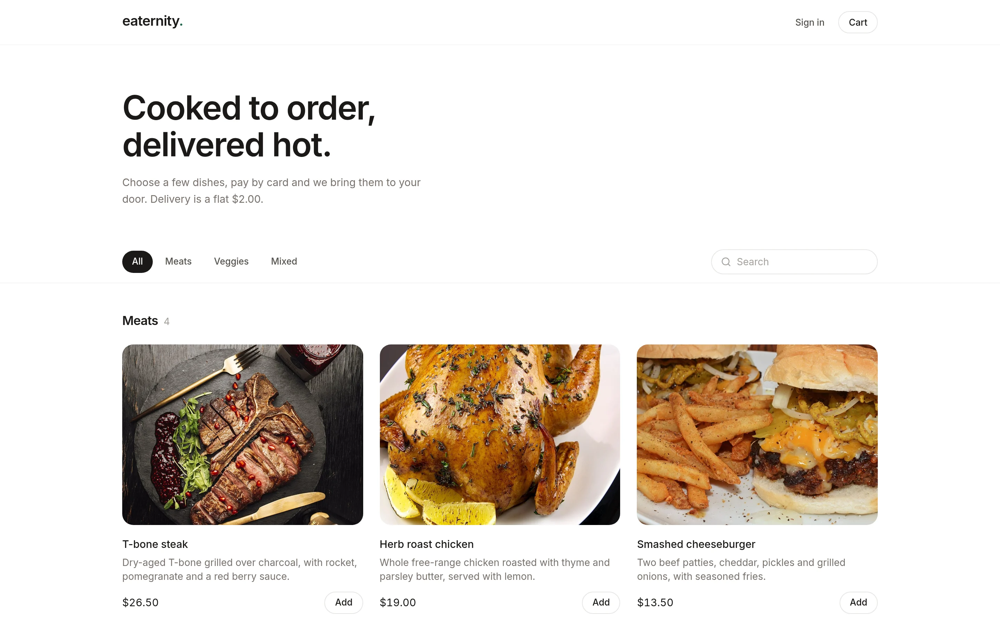
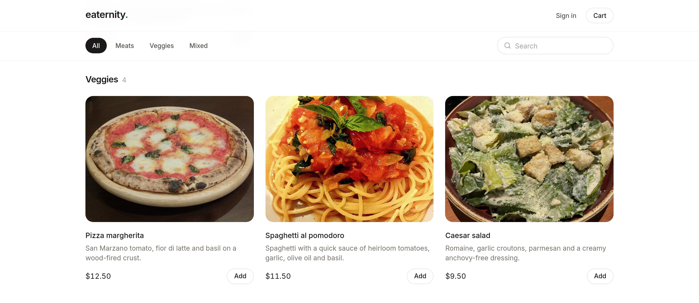
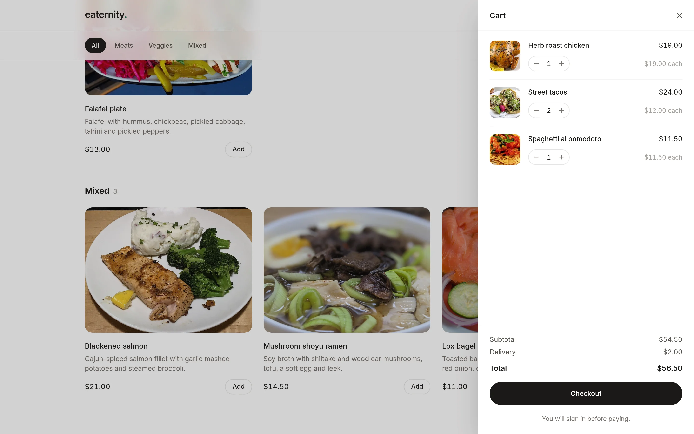
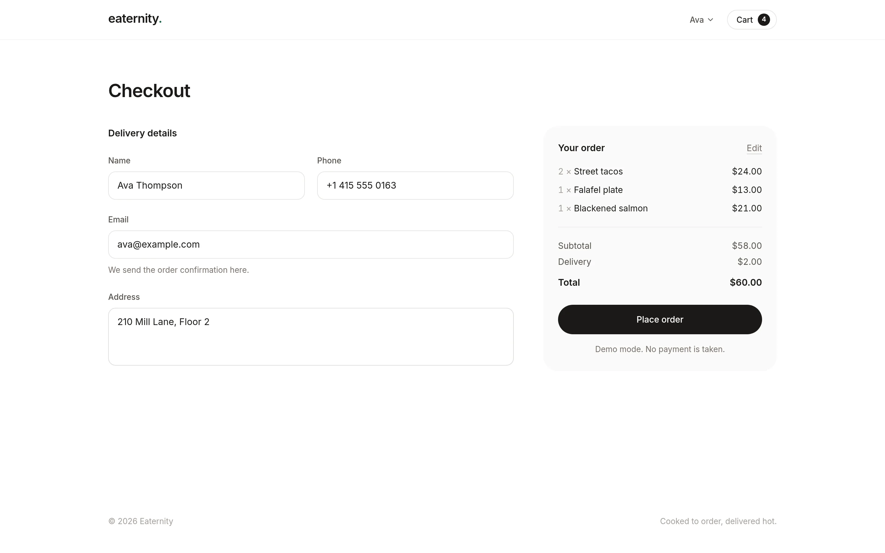
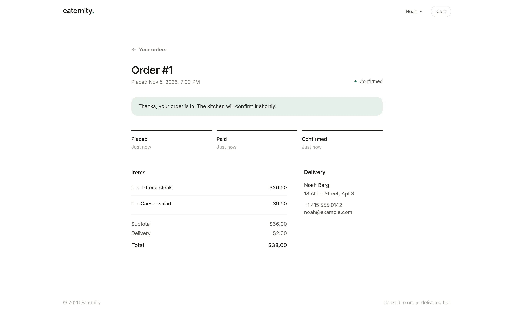
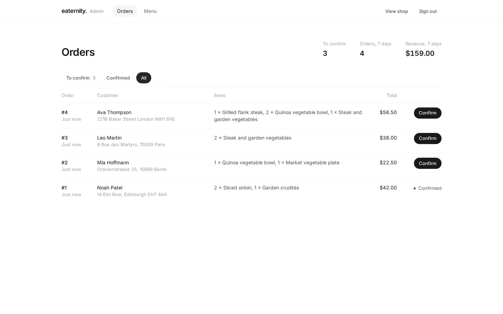
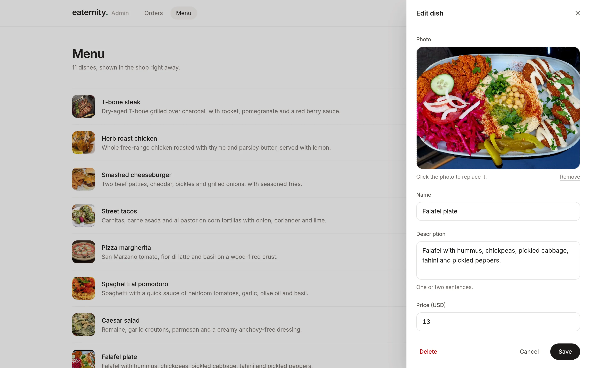
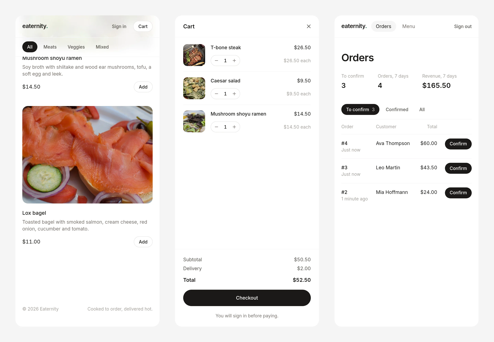

## Eaternity.

Eaternity is a food ordering web app. Customers browse the menu, fill a cart and pay with Stripe, then follow their order until the kitchen confirms it. Staff manage the menu and confirm orders on an admin page in the same app. Everything is TypeScript, and the whole thing runs as one container with a SQLite file for storage.



## Run it

You need Docker.

```sh
docker run -d --name eaternity -p 8080:8080 -v eaternity:/data matthew552/eaternity
```

Open http://localhost:8080 for the shop and http://localhost:8080/admin for the admin page. The admin email is `admin@eaternity.local`. A password is generated on first start and printed in the logs:

```sh
docker logs eaternity
docker exec eaternity cat /data/admin-password
```

The menu starts out empty. Sign in to the admin page, add a few dishes and they show up in the shop right away.

Without a Stripe key the app runs in demo mode: checkout skips the payment page and the order counts as paid. See [Configuration](#configuration) for real payments and confirmation emails.

The database, uploaded photos and the generated password all live in the `eaternity` volume. `docker rm -f eaternity` removes the container and keeps the data. `docker volume rm eaternity` deletes the data as well.

The image is [matthew552/eaternity](https://hub.docker.com/r/matthew552/eaternity) on Docker Hub, built for `linux/amd64` and `linux/arm64`.

### With Compose

[`docker-compose.yml`](docker-compose.yml) passes every setting through from a `.env` file next to it:

```sh
curl -O https://raw.githubusercontent.com/shtmthw/eaternity/main/docker-compose.yml
docker compose up -d
docker compose logs app
```

## What it looks like

The menu is grouped by category, and each dish has a photo, a short description and a price. The search box filters by name and description as you type.



Once something is in the cart, a bar at the bottom of the menu shows the running total. The cart slides in from the side, and checkout asks for an account before payment.

<p>
  
  
</p>

After paying, the order page shows each step as it happens. It checks for the kitchen's confirmation on its own.



The admin page lists new orders as they come in, with the week's numbers at the top. Dishes are added and edited in a side panel, and photos are resized in the browser before upload.

<p>
  
  
</p>

The shop and the admin page both work on a phone.



## How orders work

1. The cart lives in the browser, so guests can fill it without an account. Checkout needs one.
2. The browser sends only dish ids and quantities. The server looks up current prices, adds the delivery fee and saves the order.
3. With Stripe set up, the customer pays on Stripe Checkout. When Stripe sends them back, the server asks Stripe whether the session was paid before it marks the order as paid. If they cancel instead, the order is marked as cancelled and the cart is left as it was.
4. Paid orders wait under "To confirm" on the admin page. Confirming one updates the customer's order page and, if email is set up, sends them a confirmation.

## Configuration

Settings are environment variables, and all of them are optional. With Compose, put them in a `.env` file next to `docker-compose.yml`. [`.env.example`](.env.example) lists them with comments.

| Variable                 | Default                     | Description                                                                                                                            |
| ------------------------ | --------------------------- | -------------------------------------------------------------------------------------------------------------------------------------- |
| `PORT`                   | `8080`                      | Port the server listens on. With Compose, the port on your machine.                                                                    |
| `PUBLIC_URL`             | the requested address       | Address Stripe sends customers back to. Set it when the app has its own domain.                                                        |
| `TRUST_PROXY`            | `false`                     | Trust `X-Forwarded-For`, `-Proto` and `-Host`. Turn it on behind a reverse proxy.                                                      |
| `ADMIN_EMAIL`            | `admin@eaternity.local`     | Email of the admin account. The account is created on start.                                                                           |
| `ADMIN_PASSWORD`         | generated                   | Password of the admin account. When empty, one is generated on first start and saved as `admin-password` in the data folder.           |
| `CURRENCY`               | `usd`                       | Three-letter currency code. Prices are entered, shown and charged in it.                                                               |
| `DELIVERY_FEE`           | `2`                         | Flat delivery fee added to every order.                                                                                                |
| `STRIPE_SECRET_KEY`      |                             | Turns on Stripe Checkout. Without it, payments run in demo mode.                                                                       |
| `SMTP_HOST`              | `smtp.gmail.com`            | Mail server for order confirmation emails.                                                                                             |
| `SMTP_PORT`              | `465`                       | Mail server port.                                                                                                                      |
| `SMTP_SECURE`            | `true`                      | Use TLS from the start of the connection. Set to `false` for port 587.                                                                 |
| `SMTP_USER`, `SMTP_PASS` |                             | Mail credentials. Emails are sent only when both are set. For Gmail, use an [app password](https://myaccount.google.com/apppasswords). |
| `MAIL_FROM`              | `SMTP_USER`                 | Sender address.                                                                                                                        |
| `DATA_DIR`               | `./data`, `/data` in Docker | Where the database, uploaded photos and the generated password are kept.                                                               |

Changes to `ADMIN_EMAIL` and `ADMIN_PASSWORD` take effect on the next start. If you change the email, the previous admin account becomes a normal customer account.

## Development

You need Node.js 24 or newer. There is no database to install, because SQLite comes with Node.

```sh
npm install
npm run dev
```

Open http://localhost:5173. The API runs on port 8080 and Vite forwards `/api` and `/images` to it. Data goes to `./data`, and the admin password is printed on first start. To use your own settings, copy `.env.example` to `.env`.

| Command               | What it does                                                       |
| --------------------- | ------------------------------------------------------------------ |
| `npm run dev`         | Starts the API with `node --watch` and the Vite dev server.        |
| `npm run build`       | Builds the client into `dist`.                                     |
| `npm start`           | Runs the server, which also serves the built client on `PORT`.     |
| `npm test`            | Runs the tests with Node's test runner.                            |
| `npm run typecheck`   | Type-checks the server, the client and the shared code together.   |
| `npm run lint`        | Runs ESLint.                                                       |
| `npm run format`      | Formats the code with Prettier.                                    |
| `npm run db:generate` | Writes a new migration to `drizzle/` after a change to the schema. |

Migrations in `drizzle/` run on start.

To build the image yourself:

```sh
docker build -t matthew552/eaternity .
```

To publish both architectures:

```sh
docker buildx build --platform linux/amd64,linux/arm64 -t matthew552/eaternity:latest --push .
```

### How it is built

The server is [Hono](https://hono.dev) with [tRPC](https://trpc.io), and [Drizzle](https://orm.drizzle.team) talks to SQLite through Node's built-in `node:sqlite`. Node runs the server's TypeScript files as they are, so the server has no build step. The client is React with [TanStack Router](https://tanstack.com/router) and [TanStack Query](https://tanstack.com/query), styled with [Tailwind CSS](https://tailwindcss.com). The client gets its types straight from the server's tRPC router, and both sides validate input with the same [Zod](https://zod.dev) schemas.

Sign-in uses an HTTP-only session cookie. Sessions are stored as SHA-256 hashes and passwords with scrypt. The admin is a normal account with the admin role.

```
src/
  server/
    routers/    tRPC procedures: shop, auth, orders and admin
    services/   Sessions, Stripe, email, image uploads, rate limiting
    db/         Drizzle schema and connection
    app.ts      Hono app: security headers, tRPC, uploads, static files
  client/
    routes/     One file per page. The route tree is generated from them.
    components/ Shared UI pieces
    lib/        Cart store, hooks, formatting, forms
  shared/       Constants, money handling and Zod schemas used on both sides
drizzle/        SQL migrations
docs/           Logo and screenshots
```

### HTTP endpoints

Most of the API is tRPC under `/api/trpc`, typed end to end. The procedures are in [`src/server/routers`](src/server/routers). A few plain endpoints sit next to it:

| Method | Path            | Notes                                                               |
| ------ | --------------- | ------------------------------------------------------------------- |
| `GET`  | `/api/health`   | Returns `{ "status": "ok" }` once the database answers.             |
| `POST` | `/api/images`   | Admin only. Multipart form with an `image` field, returns its name. |
| `GET`  | `/images/:name` | Uploaded dish photos.                                               |

## Contact

Questions and suggestions are welcome at mathiwasbaroi@gmail.com.

## Photo credits

The dishes in the screenshots use photos from [Wikimedia Commons](https://commons.wikimedia.org). They were cropped to 4:3 and resized for the demo menu. Dish names and descriptions are made up for the demo and are not part of the original photos.

| Dish                  | Photo                                                                                                                                                                                                                                                                                                         | Author       | License                                                         |
| --------------------- | ------------------------------------------------------------------------------------------------------------------------------------------------------------------------------------------------------------------------------------------------------------------------------------------------------------- | ------------ | --------------------------------------------------------------- |
| T-bone steak          | [Steak served with sauce, greens and garnishes on a dark plate](https://commons.wikimedia.org/wiki/File:Steak_served_with_sauce_greens_and_garnishes_on_a_dark_plate.jpg)                                                                                                                                     | Shixart1985  | [CC BY 2.0](https://creativecommons.org/licenses/by/2.0/)       |
| Herb roast chicken    | [Max's Roasted Chicken](https://commons.wikimedia.org/wiki/File:Max%27s_Roasted_Chicken_-_Evan_Swigart.jpg)                                                                                                                                                                                                   | Evan Swigart | [CC BY 2.0](https://creativecommons.org/licenses/by/2.0/)       |
| Smashed cheeseburger  | [Cheeseburger and fries](https://commons.wikimedia.org/wiki/File:Cheeseburger_and_fries.jpg)                                                                                                                                                                                                                  | jeffreyw     | [CC BY 2.0](https://creativecommons.org/licenses/by/2.0/)       |
| Street tacos          | [Tacos de carnitas, carne asada y al pastor](https://commons.wikimedia.org/wiki/File:001_Tacos_de_carnitas,_carne_asada_y_al_pastor.jpg)                                                                                                                                                                      | Larry Miller | [CC BY-SA 2.0](https://creativecommons.org/licenses/by-sa/2.0/) |
| Pizza margherita      | [Pizza Margherita](https://commons.wikimedia.org/wiki/File:Pizza_Margherita_%28%29.JPG)                                                                                                                                                                                                                       | Lombroso     | [CC BY-SA 4.0](https://creativecommons.org/licenses/by-sa/4.0/) |
| Spaghetti al pomodoro | [Spaghetti with a minimalist heirloom tomato and basil sauce](https://commons.wikimedia.org/wiki/File:Spaghetti_with_a_minimalist_heirloom_tomato_and_basil_sauce.jpg)                                                                                                                                        | naotakem     | [CC BY 2.0](https://creativecommons.org/licenses/by/2.0/)       |
| Caesar salad          | [Caesar Salad from Tony Roma Restaurant](https://commons.wikimedia.org/wiki/File:Caesar_Salad_from_Tony_Roma_Restaurant-_March_2024_02.jpg)                                                                                                                                                                   | Banej        | [CC BY-SA 4.0](https://creativecommons.org/licenses/by-sa/4.0/) |
| Falafel plate         | [Falafel Plate, Restaurant The Hummusapiens, Berlin](https://commons.wikimedia.org/wiki/File:20240815_Falafel_Plate_Restaurant_The_Hummusapiens_Berlin_anagoria.jpg)                                                                                                                                          | Anagoria     | [CC BY-SA 4.0](https://creativecommons.org/licenses/by-sa/4.0/) |
| Blackened salmon      | [Blackened Cajun Salmon at the Applebee's in Fair Lakes](https://commons.wikimedia.org/wiki/File:2022-01-29_20_53_20_Blackened_Cajun_Salmon_%286_oz._blackened_and_grilled_salmon_fillet_with_garlic_mashed_potatoes_and_steamed_broccoli%29_at_the_Applebee%27s_in_Fair_Lakes,_Fairfax_County,_Virginia.jpg) | Famartin     | [CC BY-SA 4.0](https://creativecommons.org/licenses/by-sa/4.0/) |
| Mushroom shoyu ramen  | [Ramen Bowl](https://commons.wikimedia.org/wiki/File:Ramen_Bowl.jpg)                                                                                                                                                                                                                                          | Shisma       | [CC BY 4.0](https://creativecommons.org/licenses/by/4.0/)       |
| Lox bagel             | [Lox on Bagel, Atlanta GA](https://commons.wikimedia.org/wiki/File:Lox_on_Bagel,_Atlanta_GA.jpg)                                                                                                                                                                                                              | Pug50        | [CC BY 2.0](https://creativecommons.org/licenses/by/2.0/)       |
